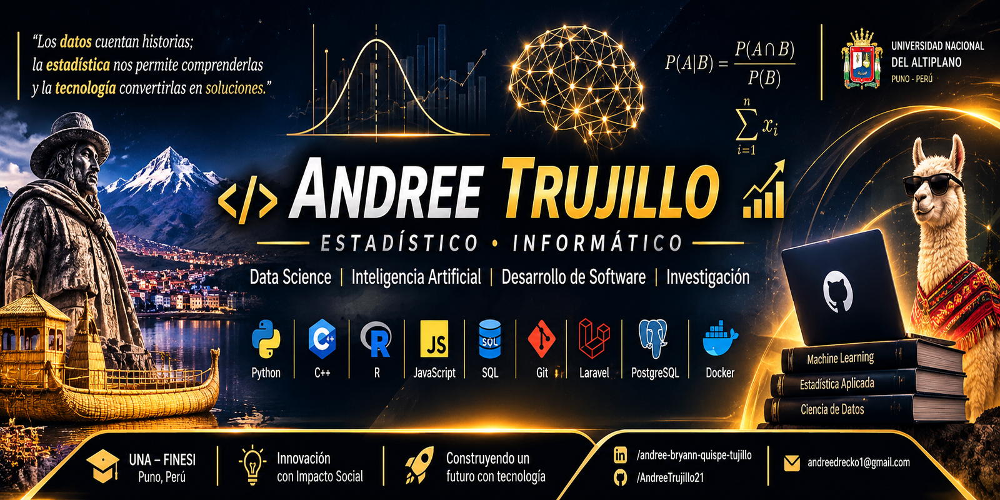

<!-- Banner de perfil -->
 
  
 <h1 align="center">¡Hola! Soy Andree Bryann Quispe Trujillo 👋</h1> <h3 align="center">Estadístico e Informático · Data Science · Inteligencia Artificial · Desarrollo de Software</h3> 
    
👨‍💻 Sobre mí
Soy estudiante de Ingeniería Estadística e Informática en la Universidad Nacional del Altiplano (UNA), Facultad de Ingeniería Estadística e Informática (FINESI) , en Puno, Perú.

Me interesa conectar el razonamiento estadístico, la programación y la investigación para convertir datos en conocimiento y desarrollar soluciones tecnológicas para problemas reales. Mis principales áreas de interés son la ciencia de datos, el aprendizaje automático, la inteligencia artificial, la visión artificial y el desarrollo de software.

También participa en actividades académicas vinculadas a la enseñanza de programación y en iniciativas de investigación universitaria.
- 📊 Estadística aplicada, análisis exploratorio y modelamiento.
- 🤖 Machine Learning, Deep Learning y visión artificial.
- 💻 Desarrollo de software, aplicaciones y sistemas web.
- 🔬 Investigación científica y proyectos interdisciplinarios.
- 🌎 Soluciones tecnológicas con impacto en la región de Puno.
🧰 Tecnologías y herramientas
Lenguajes

       
Datos, IA y desarrollo

          
Tecnologías que utilizo o con las que estoy desarrollando experiencia; no implica el mismo nivel de dominio en todas.
🚀 Proyectos
🌎Turiscovery
Plataforma digital enfocada en la promoción y organización de la oferta turística de Puno: experiencias, eventos, promociones y atractivos. El proyecto contempla tecnologías web, PostgreSQL/PostGIS y mapas interactivos.
🦙Atlas Andino 3D
Aplicación educativa de anatomía tridimensional orientada principalmente a estudiantes de Medicina Veterinaria y Zootecnia. Busca facilitar la exploración de estructuras anatómicas mediante modelos 3D, etiquetas y actividades de aprendizaje.
👁️ NAYRA-IA
Proyecto en desarrollo conceptual de tecnología asistencial para apoyar la autonomía de personas con discapacidad visual en la región de Puno. La propuesta explora visión artificial, detección de obstáculos, lectura de documentos, reconocimiento de billetes y asistencia por voz.
🔬Laboratorio de Investigación ODIN
Iniciativa académica vinculada a la investigación, el análisis estadístico y el desarrollo de proyectos científicos y tecnológicos desde el ámbito universitario.
📚 Intereses de investigación
- Ciencia de Datos y Estadística Computacional.
- Aprendizaje automático y aprendizaje profundo.
- Visión Artificial y tecnologías asistenciales.
- Serie de tiempo: ARIMA y SARIMA.
- Aprendizaje no supervisado y análisis multivariado.
- Sistemas de información geográfica y análisis espacial.
- Tecnología educativa y visualización 3D.
🤝 Colaboración
Estoy abierto a colaborar en proyectos de ciencia de datos, inteligencia artificial, investigación aplicada y desarrollo de software, especialmente en iniciativas interdisciplinarias con impacto social.
📫 Contacto
- Correo:  andreedrecko1@gmail.com
- LinkedIn:  Andree Bryann Quispe Trujillo
- GitHub: @andreeeTrujillo21
- Ubicación: Puno, Perú 🇵🇪

 <i>“Los datos cuentan historias; la estadística nos permite comprenderlas y la tecnología convertirlas en soluciones.”</i> 

